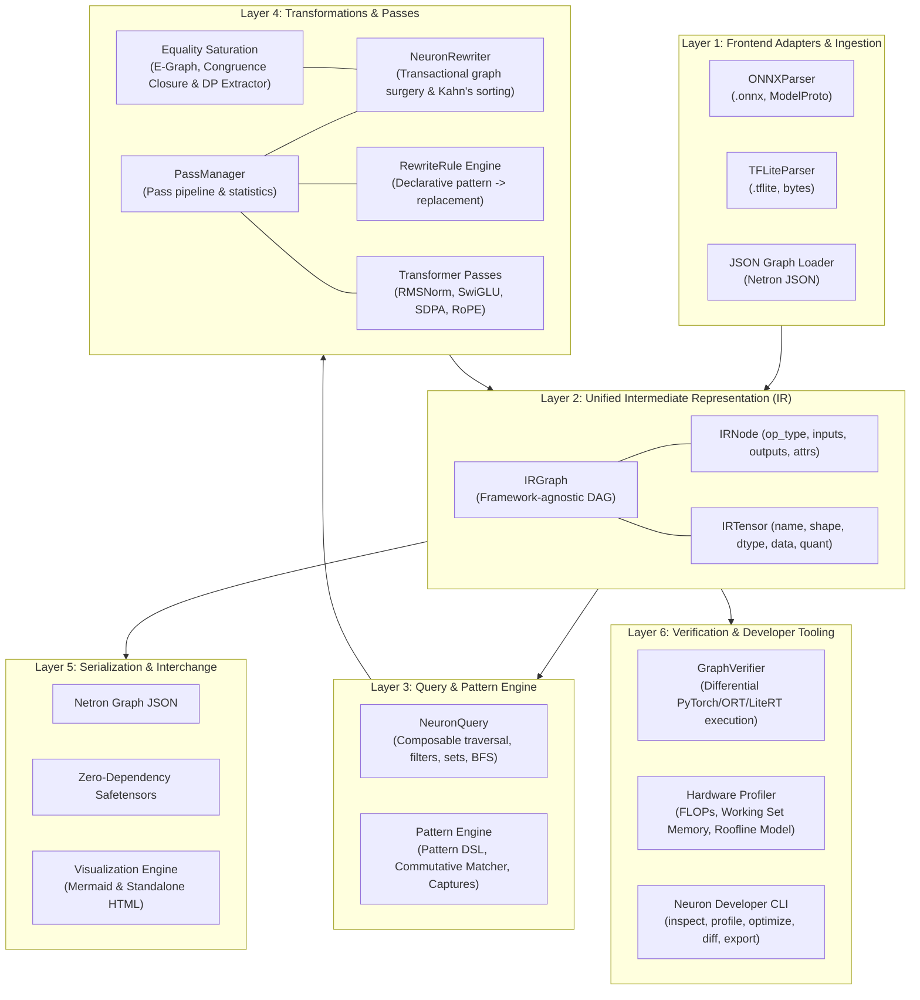

# System Architecture

## Overview

`neuron-toolkit` is built as a **decoupled, 6-layer architecture** for inspecting, analyzing, optimizing, and transforming neural network computational graphs across formats (ONNX, TFLite, and custom IR).

---

## 6-Layer Decoupled Architecture

---

## Subsystem Internals

### 1. Unified Intermediate Representation (`neuron_toolkit.ir`)

`neuron-toolkit` decouples analysis and optimization algorithms from proprietary binary protobuf and flatbuffer definitions:

- **`IRTensor`**: Strongly-typed dataclass representing activation tensors or static initializers with symbolic/dynamic shapes, numerical data types, and quantization parameters.
- **`IRNode`**: Strongly-typed dataclass encapsulating operator type, name, ordered input/output tensor references, domain, and normalized attribute dictionaries.
- **`IRGraph`**: Unified Directed Acyclic Graph (DAG) with $O(1)$ producer and consumer lookups, topological order validation, and JSON serialization.
- **`BackendAdapter`**: SPI protocol implemented by `ONNXAdapter` and `TFLiteAdapter` for format ingestion and emission.

---

### 2. Query Engine (`NeuronQuery`)

`NeuronQuery` provides an immutable, fluent builder for querying nodes. Every filtering operation (`.op()`, `.filter()`, `.name()`) returns a cloned `NeuronQuery` instance.

- **True BFS & Multi-Source Traversals**: Computes `ancestors()` and `descendants()` using double-ended queues (`collections.deque`) with unbounded maximum traversal limits (`max_depth=None`).
- **Evaluation Terminals**: Terminate queries with `.all()`, `.to_list()`, `.first()`, `.last()`, or `.count()`.

---

### 3. Pattern Matching Engine (`PatternDetector`)

- **Extensible Commutative Matching**: Automatically permutes inputs for all commutative operators (`Add`, `Mul`, `And`, `Or`, `Xor`, `Equal`, `Min`, `Max`, `Bitwise*`) or nodes explicitly tagged with `.commutative()`.
- **Referential Consistency**: Guarantees multi-reference variables bind to identical node instances.
- **Declarative `RewriteRule`**: Pairs a symbolic `Pattern` with transformation callbacks or operator replacements.

---

### 4. Transformation Passes (`PassManager`)

- **`PassManager`**: Orchestrates pipelines of `BasePass` instances, validating graph invariants, handling rollback on error, and reporting node reduction statistics.
- **Standard & Transformer Passes**:
  - `FuseConvBN`: Fuses BatchNormalization scale, bias, mean, and variance into preceding Convolution weights.
  - `DeadCodeElimination`: Recursively eliminates unconsumed orphan nodes that do not contribute to graph outputs.
  - `ConstantFolding`: Statically evaluates operations whose inputs are constant initializers at compile-time (supports Add, Sub, Mul, Div, Neg, Relu).
  - `CommonSubexpressionElimination` (`CSE`): Identifies and eliminates redundant operations consuming identical inputs.
  - `FuseGELU`: Fuses Erf-based or Tanh-approximated GELU subgraphs into a unified `Gelu` operator.
  - `FuseLayerNorm`: Fuses 7-op normalization subgraphs (ReduceMean, Sub, Pow, Div, Sqrt, Add, Mul) into `LayerNormalization`.
  - `FuseConvActivation`: Combines `Conv` followed by `Relu`, `LeakyRelu`, or `Clip` into a single `FusedConv` operator.
  - `FuseRMSNorm`: Fuses multi-op RMSNorm subgraphs into unified `RMSNorm`.
  - `FuseSwiGLU`: Fuses SiLU/Sigmoid gating branches and projections into `SwiGLU` / `GeGLU`.
  - `FuseAttention`: Fuses Scaled Dot-Product Attention into `ScaledDotProductAttention`.
  - `FuseRotaryEmbedding`: Fuses RoPE slicing, negation, and rotation into `RotaryEmbedding`.

---

### 5. Equality Saturation & E-Graphs (`neuron_toolkit.egraph`)

Solves the compiler phase ordering problem by applying rewrites non-destructively:

- **`EGraph`**: Manages equivalence classes (`EClass`) containing equivalent operator nodes (`ENode`).
- **Incremental Congruence Closure (`rebuild()`)**: Propagates equivalences upward to parent expressions using union-find with path compression.
- **Optimal Extraction (`Extractor`)**: Uses dynamic programming / Dijkstra on the e-graph using `CostModel` (`NodeCountCostModel` or `ComputeCostModel`) to extract the globally optimal DAG.

---

### 6. Hardware-Aware Profiling & Memory Planning (`neuron_toolkit.profiler`)

- **`FLOPsProfiler`**: Analytical FLOPs and MACs calculation for Convolutions, MatMuls, Attention, Normalization, and elementwise activations.
- **`MemoryTimelineSimulator`**: Simulates activation tensor lifetimes, evaluates peak working set vs naive memory, and calculates buffer reuse potential via greedy interval coloring.
- **`RooflineAnalysis`**: Evaluates Arithmetic Intensity against hardware Ridge Points (`A100`, `H100`, `RTX_4090`, `M3_MAX`, `ARM_CORTEX`) and predicts lower-bound latency.

---

### 7. Visualization & Developer Tooling

- **`to_mermaid()`**: Emits standard GitHub-flavored Mermaid flowchart diagrams.
- **`to_html()`**: Generates standalone, interactive HTML graph visualizations without external dependencies.
- **CLI (`neuron`)**: Command-line tool with `inspect`, `profile`, `optimize`, `diff`, and `export` subcommands.
