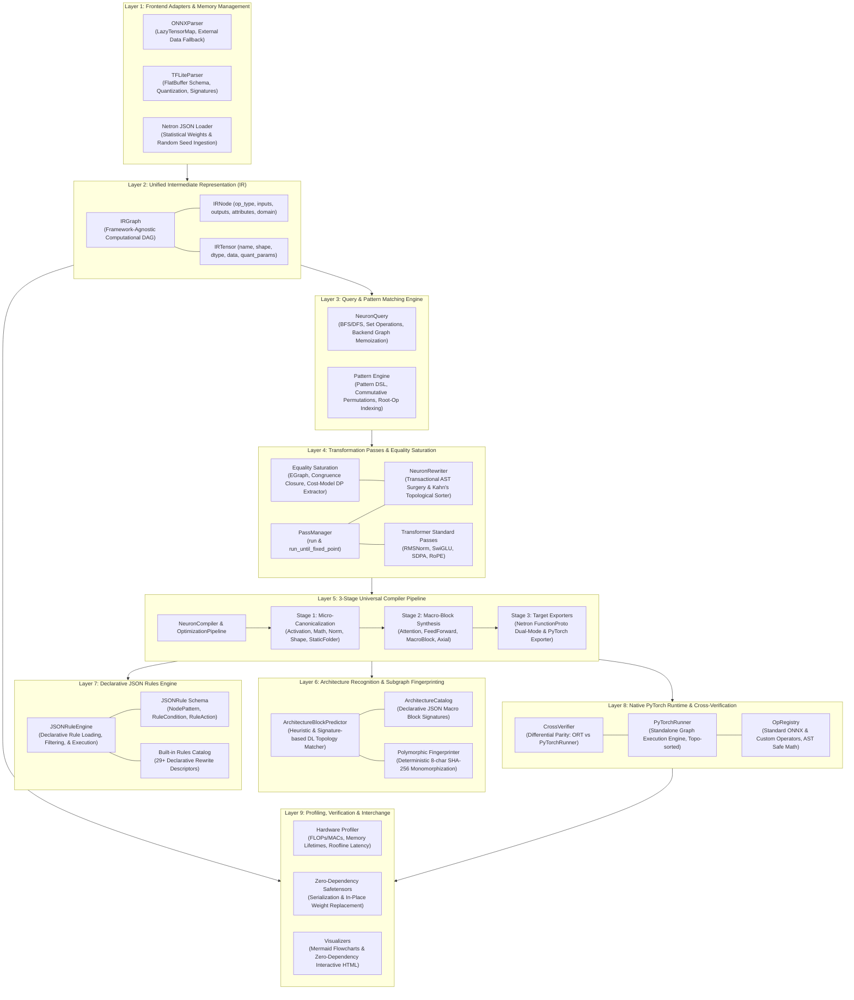

# System Architecture & Technical Design

`neuron-toolkit` is built as an extensible, decoupled multi-layer compiler and graph transformation platform. It bridges neural computational graph formats (ONNX, TFLite, Safetensors, and custom IR), providing tools for pattern recognition, optimization, hardware profiling, native execution, and numerical verification.

---

## High-Level Architecture Diagram



---

## Subsystem Details & Technical Deep Dive

### 1. Ingestion & Frontend Parsers (`neuron_toolkit.backends`)

`neuron-toolkit` decouples analysis and optimization algorithms from underlying file formats:

- **`ONNXParser`**: Parses `.onnx` models with automatic shape inference. Includes graceful degradation for detached external data buffers (`load_external_data=False`) to allow inspecting giant multi-gigabyte models without requiring raw tensor storage.
- **`LazyTensorMap`**: Memory-efficient dictionary mapping weight names to NumPy arrays with on-demand zero-copy array decoding and automatic memory eviction.
- **`TFLiteParser` & `TFLiteRewriter`**: Deep FlatBuffer ingestion and serialization supporting quantization parameters, sparsity descriptors, metadata blocks, signature defs, and custom operator options.
- **`Netron JSON Loader`**: Reconstructs complete computational DAGs from Netron-compatible JSON files, with weight buffer generation using reproducible seeds or HuggingFace Safetensors.

---

### 2. High-Performance Query Engine (`neuron_toolkit.query`)

The `NeuronQuery` fluent builder provides SQL-like filtering and traversal over graph nodes:

- **Backend Memoization**: Caches topological dependency DAGs (`_cached_nx_graph`, `_cached_rx_graph`, `_cached_output_map`, `_cached_node_to_idx`) directly on the backend parser. Subsequent queries reuse graphs in $O(1)$ time without rebuilding.
- **Optimized Traversal**: Fast multi-source Breadth-First Search (BFS) using double-ended queues (`collections.deque`) with early termination and NetworkX `descendants()` / `ancestors()` delegation for unbounded traversals.
- **Set Operations**: First-class support for boolean set algebra (`q1 | q2`, `q1 & q2`, `q1 - q2`).

---

### 3. Pattern Matching Engine (`neuron_toolkit.pattern`)

- **Root-Op Indexing**: The `PatternDetector` indexes all graph nodes by opcode (`op_to_nodes`). Pattern searches immediately filter candidates down to matching root operators, eliminating expensive full-graph traversals.
- **Commutative Input Permutations**: Automatically tests permutations for commutative operations (`Add`, `Mul`, `Min`, `Max`, `Equal`, `LogicalAnd`, `LogicalOr`).
- **Declarative Constraints**: Match constraints on tensor shapes, ranks, numerical dtypes, and attribute dictionaries.

---

### 4. 3-Stage Universal Compiler Pipeline (`neuron_toolkit.compiler`)

The compiler layer introduces an enterprise-grade, sequential 3-stage optimization pipeline:

```
Stage 1: Micro-Canonicalization -> Stage 2: Macro-Block Synthesis -> Stage 3: Target Exporters
```

#### Stage 1: Micro-Canonicalization

Standardizes low-level operator expressions and eliminates redundancies:

- **`ActivationCanonicalizer`**: Canonicalizes ERF GELU, Tanh GELU, SiLU, HardSwish, Mish, Relu6, and Softmax.
- **`MathCanonicalizer`**: Continuous constant arithmetic collapse and Linear Gemm fusion. Deduplicates transposed initializers on shared weight matrices.
- **`NormCanonicalizer`**: Opset-compatible LayerNorm, RMSNorm, GroupNorm, and SkipNorm fusions with version-dependent upgrades (Opset 17, 21, 23).
- **`ShapeCanonicalizer`**: Traverses control-flow subgraphs (`If`, `Loop`) to fold Cast initializers, perform DCE, and apply CSE while safeguarding exposed graph output constants.
- **`StaticFolder`**: Statically folds constant shapes, slice expressions, and identity ScatterND updates.

#### Stage 2: Macro-Block Synthesis

Synthesizes high-level neural building blocks:

- **`AttentionSynthesizer`**: Fuses ScaledDotProductAttention, SplitQKV, MergeHeads, RoPE, and GatedAttention.
- **`FeedForwardSynthesizer`**: Fuses monolithic MLP and SwiGLU FFN blocks with content-hashed FunctionProtos.
- **`MacroBlockSynthesizer`**: Fuses SpatialGatingUnit (gMLP), Highway networks, Squeeze-and-Excitation (3D sequence and 4D spatial), and DeepMLP blocks.
- **`AxialSynthesizer`**: Fuses Conformer multi-dimensional tensor rearrangements and tensor unbinding.

#### Stage 3: Target Exporters

- **`OnnxExporter`**: Dual-mode export generating either Netron-expandable `FunctionProto` graphs or plain custom ops.
- **`PyTorchExporter`**: Lowers optimized graphs directly into executable `PyTorchRunner` objects.

---

### 5. Semantic Architecture Recognition & Fingerprinting

- **`ArchitectureBlockPredictor`**: Automatically infers neural architecture family (Transformer, Diffusion DiT, Mamba SSM, ConvNeXt, GNN, ResMLP, RNN) and structural block confidence scores directly from graph topology.
- **Polymorphic Subgraph Fingerprinting (`compute_subgraph_fingerprint`)**: Computes deterministic SHA-256 content hashes of subgraphs to allow **polymorphic function monomorphization** (`FeedForward_swiglu_a1b2c3d4`). Solves the ONNX FunctionProto collision problem when structurally identical subnets have different inner hyperparameters.
- **`ArchitectureCatalog` & `SignatureEngine`**: Loads and matches declarative JSON block signatures from catalog files.

---

### 6. Declarative JSON Rules Engine (`neuron_toolkit.rules`)

- **`JSONRuleEngine`**: Loads declarative JSON rules from `definitions/` to transform computational graphs without writing imperative Python logic.
- **Declarative Schema**: Encapsulates `NodePattern`, topological predicates (`RuleCondition`), and rewriting targets (`RuleAction`).
- **`export_simplified_onnx`**: Serializes transformed graphs into Netron-compatible dual-mode ONNX representations with attached `FunctionProto` subroutines.

---

### 7. PyTorch Native Runtime & Differential Cross-Verification (`neuron_toolkit.runtime`)

- **`PyTorchRunner`**: Standalone, vectorized execution engine for standard ONNX graphs and custom operators without requiring compilation of C++ ONNX Runtime kernels.
- **`OpRegistry`**: Extensible registry mapping ONNX standard ops and custom operators (`custom.pytorch`) to PyTorch implementations. Includes an AST-based safe math evaluator (`_safe_eval_math`) for continuous math expressions stored in node docstrings.
- **`CrossVerifier`**: Differential testing harness running the unoptimized model on ONNX Runtime and the optimized model on `PyTorchRunner` to guarantee numerical equivalence across outputs using Mean Absolute Error, Max Absolute Error, Mean Squared Error, and Cosine Similarity.
