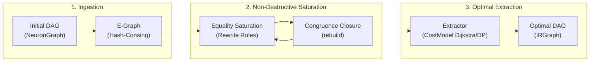

# Guide: Equality Saturation & E-Graphs

`neuron-toolkit` includes an advanced compiler optimization engine based on **Equality Saturation** and **Equivalence Graphs (E-Graphs)**. This engine avoids the classical compiler **phase ordering problem** by applying graph rewrite rules non-destructively, simultaneously exploring exponential program variations in polynomial space, and extracting the mathematically optimal DAG using dynamic programming.

---

## 1. What is Equality Saturation?

In standard pass managers, passes execute sequentially:
$$\text{Pass A} \longrightarrow \text{Pass B} \longrightarrow \text{Pass C}$$
If Pass A runs before Pass B, it may destroy the pattern needed by Pass B (e.g. constant folding before a fusion rule, or vice versa).

**Equality Saturation** solves this:

1. It ingests the computation graph into an **E-Graph**.
2. Rules apply **non-destructively**: when a rule transforms $A \to B$, both $A$ and $B$ are kept in the same equivalence class (`EClass`).
3. An incremental **Congruence Closure algorithm** (`egraph.rebuild()`) unifies equivalent parent nodes.
4. An **Extractor** evaluates a `CostModel` and extracts the single cheapest equivalent DAG.



---

## 2. Basic E-Graph Operations

Import the core data structures from `neuron_toolkit.egraph`:

```python
from neuron_toolkit.egraph import EGraph, ENode, UnionFind

eg = EGraph()

# Add leaf variables
x_id = eg.add(ENode(op="Var", attrs=(("name", "x"),)))
zero_id = eg.add(ENode(op="Const", attrs=(("value", 0.0),)))

# Add operator node: Add(x, 0)
add_id = eg.add(ENode(op="Add", children=(x_id, zero_id)))

# Check canonical representative
print("Canonical ID for x:", eg.find(x_id))
```

### Congruence Closure Invariant

If two expressions $a$ and $b$ are equivalent ($a \equiv b$), then applying any operator $f$ to them preserves equivalence ($f(a) \equiv f(b)$):

```python
a = eg.add(ENode(op="Var", attrs=(("name", "a"),)))
b = eg.add(ENode(op="Var", attrs=(("name", "b"),)))

f_a = eg.add(ENode(op="Relu", children=(a,)))
f_b = eg.add(ENode(op="Relu", children=(b,)))

# Union a and b
eg.union(a, b)
# Run incremental congruence closure
eg.rebuild()

# Now f_a and f_b are automatically proven equivalent!
assert eg.find(f_a) == eg.find(f_b)
```

---

## 3. Declarative Rewrite Rules & Saturation

`neuron-toolkit` includes standard rewrite rules:

- `CommutativeRule(op)`: $op(a, b) \equiv op(b, a)$
- `IdentityRule(op, identity_val)`: $x + 0 \equiv x$, $x \times 1 \equiv x$
- `ConstantFoldRule()`: Evaluates constants in the e-graph and unions with their scalar result.
- `SiluFusionRule()`: $x \times \text{Sigmoid}(x) \equiv \text{SiLU}(x)$

Run saturation loop with safety limits:

```python
from neuron_toolkit.egraph import default_rules, saturate

stats = saturate(eg, rules=default_rules(), max_iterations=12, node_limit=5000)
print(f"Iterations: {stats['iterations']}, Total unions: {stats['total_unions']}")
```

---

## 4. Extracting the Optimal Graph

Use `Extractor` with a specified `CostModel`:

```python
from neuron_toolkit.egraph import Extractor, NodeCountCostModel, ComputeCostModel

# 1. Minimize total node count:
extractor = Extractor(eg, cost_model=NodeCountCostModel())
cost, best_node = extractor.find_best(add_id)
print(f"Optimal node: {best_node.op} (Cost: {cost})")

# 2. Extract full IRGraph:
optimal_ir = extractor.extract_to_ir([add_id], graph_name="optimized_model")
```

---

## 5. End-to-End One-Line API (`NeuronGraph.equality_saturation`)

You can run equality saturation directly from any loaded `NeuronGraph`:

```python
from neuron_toolkit import NeuronGraph

graph = NeuronGraph.load("model.onnx")

# Run full equality saturation and extract optimal IR:
optimal_ir, stats = graph.equality_saturation(max_iterations=10)

print(f"Explored {stats['total_nodes']} equivalent nodes across {stats['final_classes']} classes.")
print(f"Final IR has {len(optimal_ir.nodes)} nodes.")
```
