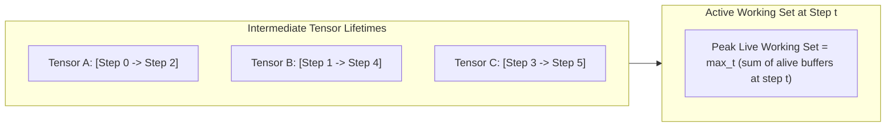

# Guide: Profiler, Memory Planning & Roofline Modeling

`neuron-toolkit` provides hardware-aware profiling and memory planning tools to analyze computational complexity (FLOPs/MACs), peak activation memory footprints, working set lifetimes, and hardware execution bottlenecks using the **Roofline Model**.

---

## 1. Quickstart: Profiling a Model

Profile any model across standard hardware targets in one line:

```python
from neuron_toolkit import NeuronGraph

graph = NeuronGraph.load("resnet50.onnx")

# Profile for NVIDIA A100 at FP16 precision:
report = graph.profile(device="a100", dtype="float16")

# Print rich formatted console summary:
print(report.summary())
```

### Example Summary Output

```text
============================================================
 NEURON TOOLKIT HARDWARE & MEMORY PROFILER: NVIDIA A100 SXM4 80GB
============================================================
  Precision:              FLOAT16
  Total Parameters:       25,557,032 params
  Compute:                8.240 GFLOPs (4.120 GMACs)
  Naive Memory:           42.50 MB
  Peak Working Set:       14.20 MB (66.6% buffer reuse)
------------------------------------------------------------
  Roofline Ridge Point:   153.02 FLOP/byte
  Arithmetic Intensity:   38.45 FLOP/byte
  Classification:         MEMORY-BOUND
  Estimated Latency:      0.215 ms
============================================================
```

---

## 2. Analytical FLOPs & MACs Profiling (`FLOPsProfiler`)

Calculate exact Floating Point Operations (FLOPs) and Multiply-Accumulate Operations (MACs) per layer:

```python
from neuron_toolkit.profiler import FLOPsProfiler

summary = FLOPsProfiler.profile(graph, default_dtype="float16")
print(f"Total GFLOPs: {summary.gflops:.3f}")
print(f"Total GMACs:  {summary.gmacs:.3f}")

# Inspect per-operator breakdown:
for op in summary.op_breakdown[:5]:
    print(f"{op.name:<30} {op.op_type:<15} FLOPs: {op.flops:,} Intensity: {op.arithmetic_intensity:.2f} FLOP/B")
```

### Supported Operator Formulations

- **Convolution (Conv, ConvTranspose)**: Accounts for spatial dimensions, kernel size, groups, strides, and bias.
- **Matrix Multiplication (MatMul, Gemm)**: Accounts for batch dimensions, inner contraction dimension $K$, and outer dimensions $M, N$.
- **Attention / SDPA**: $4 \times B \times H \times S^2 \times D + 3 \times B \times H \times S^2$ compute operations.
- **Normalization (LayerNorm, RMSNorm, BatchNorm)**: Accurate reduction and scaling costs.
- **Elementwise Activations**: Relu, SiLU, GELU, Sigmoid, Add, Mul.

---

## 3. Peak Activation Memory Simulator (`MemoryTimelineSimulator`)

Unlike naive memory estimation which simply sums all tensor sizes, `MemoryTimelineSimulator` tracks the **temporal lifetime** of every activation buffer from creation (producer node) to destruction (last consumer node):



```python
from neuron_toolkit.profiler import MemoryTimelineSimulator

mem = MemoryTimelineSimulator.simulate(graph, default_dtype="float16")

print(f"Naive Memory (Alloc without free): {mem.naive_total_mb:.2f} MB")
print(f"Peak Working Set (Ideal GC):       {mem.peak_working_set_mb:.2f} MB")
print(f"Memory Savings Potential:          {mem.memory_savings_percentage:.1f}%")
print(f"Buffer Pool Size with In-Place:    {mem.simulated_buffer_pool_bytes / (1024*1024):.2f} MB")
```

---

## 4. Roofline Model & Latency Estimation (`RooflineAnalysis`)

The **Roofline Model** evaluates whether your model's inference speed is limited by **Compute Throughput (TFLOPS)** or **Memory Bandwidth (GB/s)**:

$$\text{Arithmetic Intensity (AI)} = \frac{\text{FLOPs}}{\text{Bytes Transferred (Inputs + Outputs + Parameters)}}$$

$$\text{Ridge Point} = \frac{\text{Peak Compute Throughput (FLOPS)}}{\text{Memory Bandwidth (Bytes/s)}}$$

- If $\text{AI} < \text{Ridge Point} \implies$ **Memory-Bound** (execution time is dominated by DRAM data transfer).
- If $\text{AI} \ge \text{Ridge Point} \implies$ **Compute-Bound** (execution time is dominated by ALUs/Tensor Cores).

```python
from neuron_toolkit.profiler import RooflineAnalysis

# Compare across different devices:
for dev in ["a100", "rtx4090", "m3", "arm", "cpu"]:
    analysis = RooflineAnalysis.analyze(summary, device=dev, dtype="float16")
    print(f"Device: {analysis.target.name}")
    print(f"  Ridge Point:       {analysis.ridge_point:.2f} FLOP/byte")
    print(f"  Classification:    {'COMPUTE-BOUND' if analysis.global_point.is_compute_bound else 'MEMORY-BOUND'}")
    print(f"  Predicted Latency: {analysis.global_point.estimated_latency_ms:.3f} ms")
```

### Pre-Configured Hardware Targets

- `NVIDIA_A100_SXM4_80GB` (312 TFLOPS FP16, 2,039 GB/s)
- `NVIDIA_H100_SXM5` (989 TFLOPS FP16, 3,350 GB/s)
- `NVIDIA_RTX_4090` (165 TFLOPS FP16, 1,008 GB/s)
- `APPLE_M3_MAX` (33 TFLOPS FP16, 400 GB/s)
- `ARM_CORTEX_A78` (100 GFLOPS FP32, 34 GB/s)
- `GENERIC_CPU` (500 GFLOPS FP32, 64 GB/s)

---

## 5. Exporting Reports

```python
report = graph.profile(device="a100")

# 1. Export as JSON:
json_data = report.to_dict()

# 2. Export as Markdown table:
md_table = report.to_markdown()
with open("profile_report.md", "w") as f:
    f.write(md_table)
```
