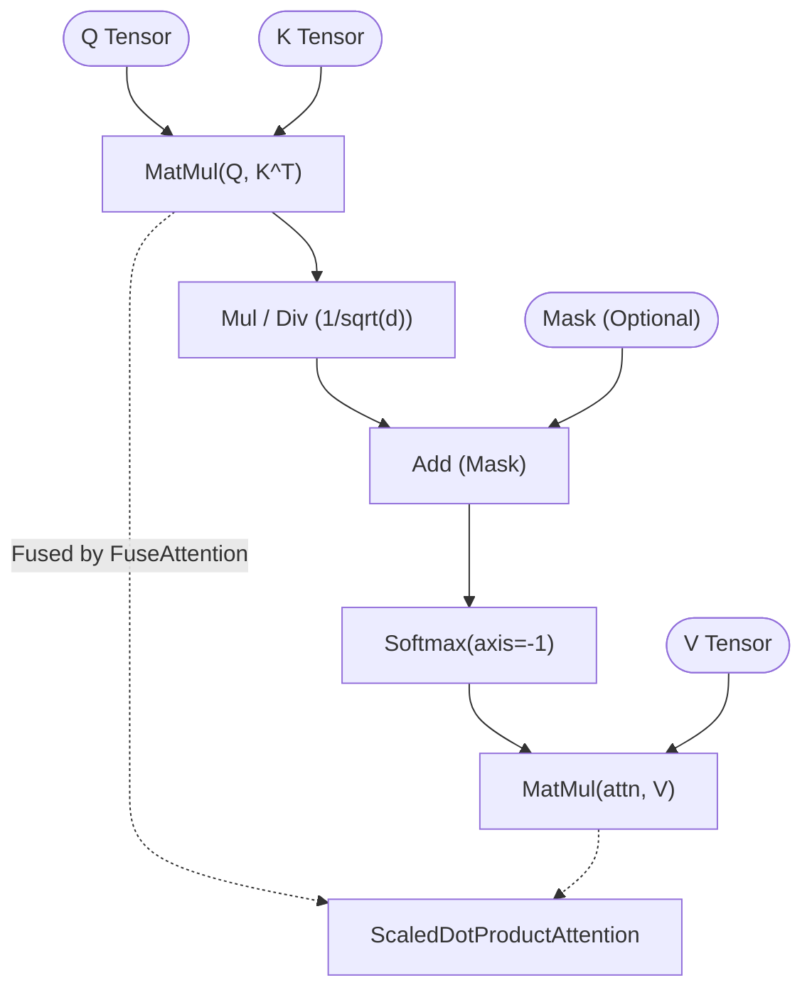

# Guide: LLM & Transformer Optimization Passes

`neuron-toolkit` provides specialized passes for optimizing generative AI and Transformer architectures (LLaMA, Mistral, Gemma, BERT, Whisper, etc.) by detecting and fusing multi-operator motifs into high-performance unified layers.

---

## 1. Supported Transformer Passes

| Pass Identifier | Class | Description |
| :--- | :--- | :--- |
| `fuse_rmsnorm`, `rmsnorm` | `FuseRMSNorm` | Fuses RMSNorm subgraphs (`Pow(2)/Mul` $\to$ `ReduceMean` $\to$ `Add` $\to$ `Sqrt` $\to$ `Div` $\to$ `Mul`) into unified `RMSNorm` |
| `fuse_swiglu`, `swiglu` | `FuseSwiGLU` | Fuses gating branches (`Mul(SiLU(gate), up)`) and upstream projections into `SwiGLU` / `GeGLU` |
| `fuse_attention`, `attention`, `sdpa` | `FuseAttention` | Fuses Scaled Dot-Product Attention ($QK^T \to \text{scale} \to \text{mask} \to \text{softmax} \to V$) into `ScaledDotProductAttention` |
| `fuse_rope`, `rope` | `FuseRotaryEmbedding` | Fuses slice, negate, concat, and $\sin/\cos$ rotations into `RotaryEmbedding` |
| `gemma2_softcapping` | `apply_gemma2_softcapping_fusion` | Fuses logits soft-capping sequences ($\text{cap} \cdot \tanh(x / \text{cap})$) into `LogitsSoftCap` |
| `deepseek_mla` | `apply_deepseek_mla_fusion` | Fuses low-rank KV compression and decoupled RoPE keys into `MultiHeadLatentAttention_KVProjection` |

---

## 2. Fusing RMS Normalization (`FuseRMSNorm`)

Modern open-weight LLMs (Llama 3, Mistral, Gemma, DeepSeek) replace standard LayerNorm with Root Mean Square Normalization:

$$\text{RMSNorm}(x) = \frac{x}{\sqrt{\frac{1}{d}\sum_{i=1}^d x_i^2 + \epsilon}} \odot \gamma$$

In un-optimized ONNX graphs, this is decomposed across 5–6 individual nodes. `FuseRMSNorm` detects both `Pow(x, 2)` and `Mul(x, x)` formulations, automatically extracts epsilon and the $\gamma$ scale weight, and replaces the subgraph with a single `RMSNorm` node:

```python
from neuron_toolkit import NeuronGraph
from neuron_toolkit.passes import FuseRMSNorm

graph = NeuronGraph.load("llama3_layer.onnx")

# Apply pass directly:
fused_graph = graph.passes.fuse_rmsnorm()

# Or using the Pass class:
pass_obj = FuseRMSNorm()
fused_graph, stats = pass_obj.run(graph)
print(f"Fused RMSNorm blocks: {stats['fused_rmsnorm_count']}")
```

---

## 3. Fusing SwiGLU / GeGLU Gated Feed-Forward Blocks (`FuseSwiGLU`)

LLaMA and PaLM models use SwiGLU activations in their multi-layer perceptron (MLP) blocks:

$$\text{SwiGLU}(x, W_{\text{gate}}, W_{\text{up}}) = \left(\text{SiLU}(x W_{\text{gate}})\right) \odot (x W_{\text{up}})$$

`FuseSwiGLU` detects both:

1. Gated activation branches (`Mul(SiLU(gate), up)`).
2. Complete projections where `gate` and `up` share the same input tensor $x$, fusing the projections and gating into `FusedSwiGLU`:

```python
from neuron_toolkit import NeuronGraph
from neuron_toolkit.passes import FuseSwiGLU

graph = NeuronGraph.load("model.onnx")
optimized_graph = graph.passes.fuse_swiglu()
```

---

## 4. Scaled Dot-Product Attention (`FuseAttention`)

Unfolds multi-op attention back into high-performance `ScaledDotProductAttention` (compatible with hardware FlashAttention runtimes):



```python
from neuron_toolkit import NeuronGraph
from neuron_toolkit.passes import FuseAttention

graph = NeuronGraph.load("transformer.onnx")
opt_graph = graph.passes.fuse_attention()
```

---

## 5. Rotary Position Embeddings (`FuseRotaryEmbedding`)

Rotary position embeddings (RoPE) rotate query and key representations via complex coordinate multiplication:

$$\text{RoPE}(x, \cos, \sin) = (x \odot \cos) + (\text{rotate\_half}(x) \odot \sin)$$

`FuseRotaryEmbedding` detects the slice, negation, and concatenation sequence and fuses it into a clean `RotaryEmbedding` operator:

```python
from neuron_toolkit import NeuronGraph

graph = NeuronGraph.load("llama_rope.onnx")
opt_graph = graph.passes.fuse_rope()
```

---

## 6. Gemma-2 Logits Soft-Capping (`apply_gemma2_softcapping_fusion`)

Gemma-2 architectures introduce logits soft-capping to bound the attention logits and final output logits without clipping gradients:

$$\text{Scores}_{\text{capped}} = \text{cap} \cdot \tanh\left(\frac{Q K^T}{\sqrt{d} \cdot \text{cap}}\right)$$

In raw exported graphs, this corresponds to a sequence of `Div(cap) -> Tanh -> Mul(cap)`. `apply_gemma2_softcapping_fusion` synthesizes this pattern into a unified `custom.pytorch::LogitsSoftCap` operator with an explicit `cap` scalar attribute:

```python
from neuron_toolkit.compiler.passes.synthesis.attention_synthesizer import apply_gemma2_softcapping_fusion

# Optimized during synthesis pass or directly:
fused_count = apply_gemma2_softcapping_fusion(graph)
print(f"Fused Gemma-2 softcapping layers: {fused_count}")
```

---

## 7. DeepSeek Multi-Head Latent Attention (`apply_deepseek_mla_fusion`)

DeepSeek-V2 and DeepSeek-V3 introduce Multi-Head Latent Attention (MLA) to compress key-value cache memory via low-rank latent vector compression and decoupled RoPE keys:

$$c_{KV} = X W_{DKV}, \quad K_C = c_{KV} W_{UK}, \quad V = c_{KV} W_{UV}, \quad K_R = \text{RoPE}(X W_{KR})$$

`apply_deepseek_mla_fusion` identifies down-projection matrix multiplications into compressed latent vectors feeding upward key and value projections, fusing them into a monolithic `custom.pytorch::MultiHeadLatentAttention_KVProjection`:

```python
from neuron_toolkit.compiler.passes.synthesis.attention_synthesizer import apply_deepseek_mla_fusion

# Detects and fuses low-rank compression projections:
mla_count = apply_deepseek_mla_fusion(graph)
print(f"Fused DeepSeek MLA blocks: {mla_count}")
```

---

## 8. End-to-End LLM Optimization Pipeline

Combine all passes into a comprehensive pipeline using `PassManager`:

```python
from neuron_toolkit import NeuronGraph
from neuron_toolkit.passes import (
    CommonSubexpressionElimination,
    ConstantFolding,
    DeadCodeElimination,
    FuseAttention,
    FuseRMSNorm,
    FuseRotaryEmbedding,
    FuseSwiGLU,
    PassManager,
)

graph = NeuronGraph.load("llama_block.onnx")

pm = PassManager([
    ConstantFolding(),
    CommonSubexpressionElimination(),
    FuseRMSNorm(),
    FuseSwiGLU(),
    FuseAttention(),
    FuseRotaryEmbedding(),
    DeadCodeElimination(),
])

optimized_graph, stats = pm.run(graph)
print(stats.summary())
optimized_graph.save("llama_block_fused.onnx")
```
