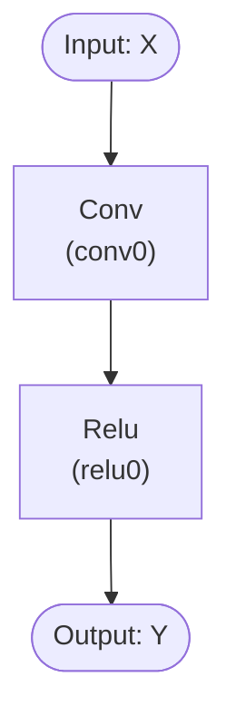

# Guide: Model Visualization

`neuron-toolkit` provides native tools for inspecting model topologies through text diagrams, GitHub-flavored Markdown Mermaid flowcharts, and standalone interactive HTML visualizers.

---

## 1. Terminal Text Summary

Print a structured ASCII representation of your graph directly in the console or Jupyter Notebook:

```python
from neuron_toolkit import NeuronGraph

graph = NeuronGraph.load("model.onnx")
print(graph)
```

---

## 2. Mermaid Flowchart Diagrams

Export your computation graph as a standard GitHub-flavored Mermaid flowchart:

```python
mermaid_code = graph.to_mermaid(max_nodes=100)
print(mermaid_code)
```

You can embed this directly in Markdown files, documentation, or PR descriptions:



---

## 3. Standalone Interactive HTML Visualizer

Generate an interactive HTML visualization page that can be opened in any web browser without needing Netron or any external installation:

```python
# Save interactive HTML page
graph.to_html("model_visualization.html")
```

The exported page includes:

- Total node, input, and output metric badges.
- Zoomable, pannable graph topology canvas powered by client-side Mermaid.js rendering.
- Zero local dependencies.
