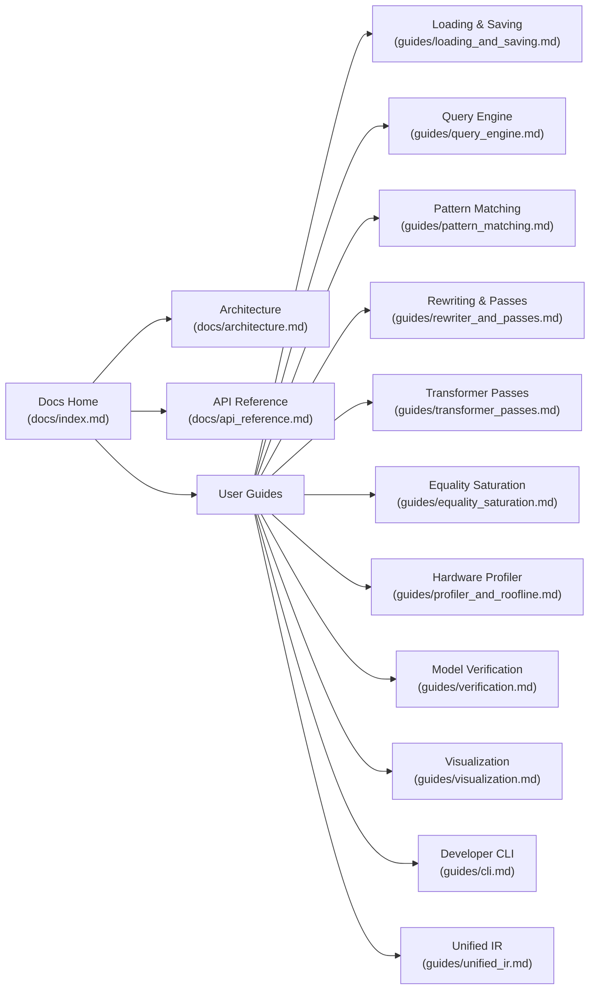

# `neuron-toolkit` Documentation

**A Unified ONNX and TFLite Parsing, Querying, Pattern-Matching, and Transformation Toolkit.**

`neuron-toolkit` provides a high-level, framework-agnostic Python interface for deep learning model surgery, pattern matching, graph querying, and numerical verification. It bridges the gap between disparate model formats (ONNX, TFLite, and Netron-compatible JSON), empowering compiler engineers, optimization researchers, and ML infrastructure developers to manipulate neural computational graphs effortlessly.

---

## Key Highlights

- 🔍 **Fluent Query Engine**: Chainable, SQL-like queries to traverse, filter, and inspect computational nodes (`graph.query().op("Conv").has_params()`).
- 🧩 **Pattern Matching DSL**: Declarative subgraph pattern matching with operator overloads (`x * Pattern.op("Sigmoid", x)`), captures, wildcards, and constraints.
- ⚡ **Transformer & LLM Optimization Passes**: Pre-packaged fusion passes for `RMSNorm`, `SwiGLU`, `ScaledDotProductAttention`, and `RotaryEmbedding` (RoPE).
- 🔄 **Equality Saturation (E-Graphs)**: Solves the compiler phase ordering problem by applying rewrites non-destructively and extracting the optimal DAG using dynamic programming.
- 📊 **Hardware Profiler & Roofline Latency Modeling**: Analytical FLOPs/MACs calculator, chronological active working set memory simulation, and Roofline model bottleneck classification across NVIDIA A100/H100, RTX 4090, Apple Silicon, and ARM.
- ✂️ **Graph Surgery & Rewriting**: Staged, topological-preserving node replacement, insertion, and deletion (`rewriter.replace(...)`).
- 📦 **Zero-Dependency Safetensors Serialization**: Built-in weight serializer and loader conforming to HuggingFace `.safetensors` standards without requiring Rust toolchains.
- 📊 **Netron-Compatible JSON Export**: Export graph topologies with statistical weight summaries (min, max, mean, std, zero fraction) without saving raw weight buffers.
- 🔬 **Differential Verification**: Extract subgraphs between arbitrary points and verify numerical equivalence against PyTorch or ONNXRuntime with automated tolerance checks (MAE, MSE, cosine similarity).

---

## Quick Start in 60 Seconds

### Installation

```bash
# Core installation with ONNX support:
pip install "neuron-toolkit[onnx]"

# Full installation with TFLite and evaluation support:
pip install "neuron-toolkit[all]"
```

### 1. Load and Query a Model

```python
from neuron_toolkit import NeuronGraph

# Load any ONNX or TFLite model:
graph = NeuronGraph.load("resnet18.onnx")

# Query all Convolution layers with kernel_size == 3:
conv_nodes = (
    graph.query()
    .op("Conv")
    .filter(lambda n: n.attrs.get("kernel_shape") == [3, 3])
    .all()
)
print(f"Found {len(conv_nodes)} 3x3 Conv layers.")
```

### 2. Match and Fuse Subgraphs (e.g. SiLU Activation)

```python
from neuron_toolkit import NeuronGraph, Pattern

graph = NeuronGraph.load("model.onnx")

# Define pattern: x * Sigmoid(x) -> SiLU
x = Pattern.any().capture("input_tensor")
silu_pattern = x * Pattern.op("Sigmoid", x)

# Find all occurrences and replace with a unified "Silu" op:
rewriter = graph.replace(silu_pattern, "Silu")
optimized_model = rewriter.build(output_path="model_fused.onnx")
```

### 3. Export to JSON (Netron Visualizer Compatible)

```python
# Export clean JSON structure with weight statistics:
json_string = graph.to_json(path="model_graph.json", indent=2)
```

---

## Documentation Navigation



### Guides

1. [**Architecture & Design Philosophy**](file:///home/jenil-sheth/Desktop/Backup/neuron-toolkit/docs/architecture.md): Decoupled 6-layer architecture, graph representations, and execution flow.
2. [**Loading & Saving Models**](file:///home/jenil-sheth/Desktop/Backup/neuron-toolkit/docs/guides/loading_and_saving.md): Working with `.onnx`, `.tflite`, JSON representations, and `.safetensors`.
3. [**Query Engine Guide**](file:///home/jenil-sheth/Desktop/Backup/neuron-toolkit/docs/guides/query_engine.md): Filtering by op/name/attribute, graph traversals, and boolean set operations.
4. [**Pattern Matching DSL**](file:///home/jenil-sheth/Desktop/Backup/neuron-toolkit/docs/guides/pattern_matching.md): Building subgraph patterns, wildcards, arithmetic overloads, and commutative matching.
5. [**Graph Rewriting & Passes**](file:///home/jenil-sheth/Desktop/Backup/neuron-toolkit/docs/guides/rewriter_and_passes.md): Performing in-place AST surgery, PassManager, and RewriteRule engine.
6. [**Transformer & LLM Passes**](file:///home/jenil-sheth/Desktop/Backup/neuron-toolkit/docs/guides/transformer_passes.md): Fusing RMSNorm, SwiGLU, SDPA/Attention, and RotaryEmbeddings.
7. [**Equality Saturation & E-Graphs**](file:///home/jenil-sheth/Desktop/Backup/neuron-toolkit/docs/guides/equality_saturation.md): Non-destructive optimization and dynamic programming DAG extraction.
8. [**Hardware Profiler & Roofline Model**](file:///home/jenil-sheth/Desktop/Backup/neuron-toolkit/docs/guides/profiler_and_roofline.md): FLOPs/MACs, peak activation working set simulation, and latency limits.
9. [**Model Verification & Slicing**](file:///home/jenil-sheth/Desktop/Backup/neuron-toolkit/docs/guides/verification.md): Slicing subgraphs, LiteRT execution, and differential verification against PyTorch.
10. [**Model Visualization**](file:///home/jenil-sheth/Desktop/Backup/neuron-toolkit/docs/guides/visualization.md): Mermaid diagrams and interactive HTML visualizer.
11. [**Developer CLI**](file:///home/jenil-sheth/Desktop/Backup/neuron-toolkit/docs/guides/cli.md): Using the `neuron` command line tool (`inspect`, `profile`, `optimize`, `diff`, `export`).
12. [**Unified Intermediate Representation**](file:///home/jenil-sheth/Desktop/Backup/neuron-toolkit/docs/guides/unified_ir.md): Working with framework-agnostic IRGraph, IRNode, and IRTensor.
13. [**Complete API Reference**](file:///home/jenil-sheth/Desktop/Backup/neuron-toolkit/docs/api_reference.md): Full signature and docstring documentation for all public modules.
